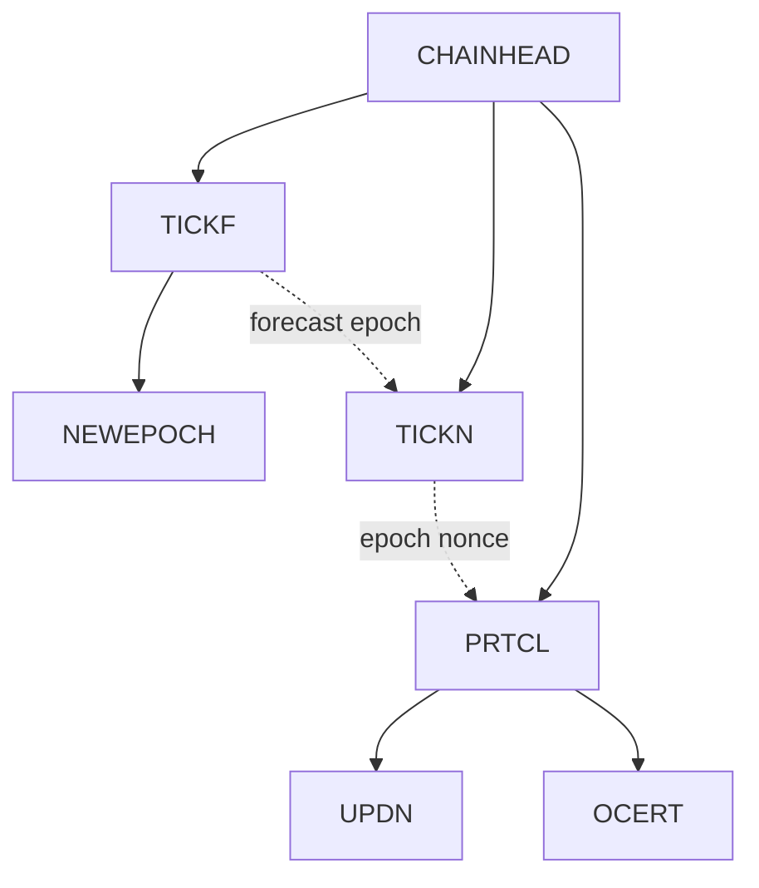

# Transition Rule Dependencies

Each node represents a transition rule. Solid arrows connect a rule to its
sub-rules. Dotted arrows show where the result of one sub-rule is used by another.

The main rule is [CHAINHEAD](../src/Spec/ChainHead.lagda.md).
[NEWEPOCH](../src/InterfaceLibrary/Ledger.lagda.md) is supplied by the ledger
interface. The remaining rules are defined by this specification.

[Specification contents](../SPECIFICATION.md)
