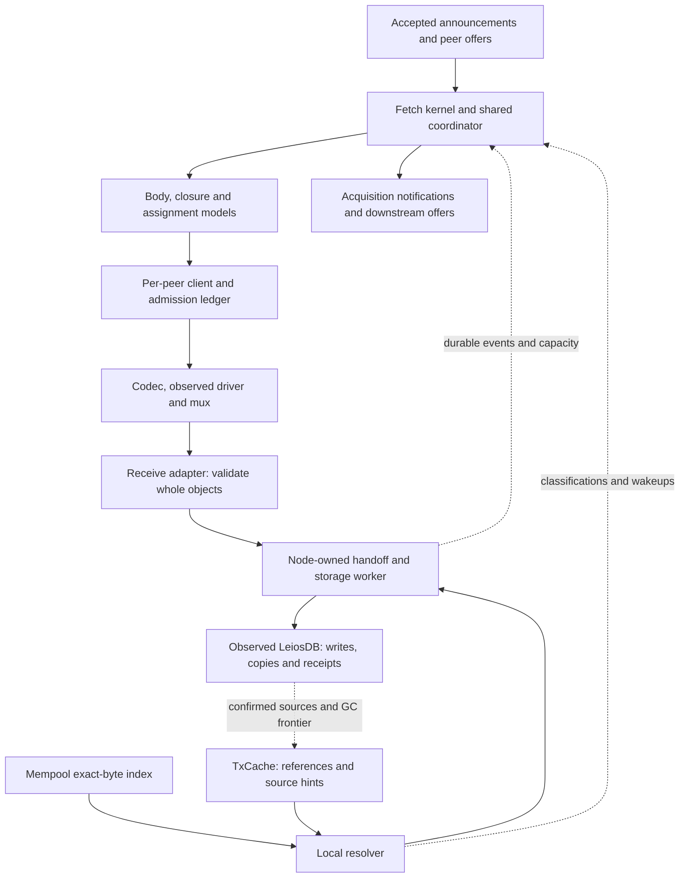
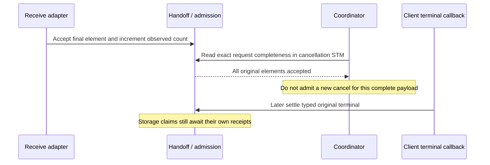
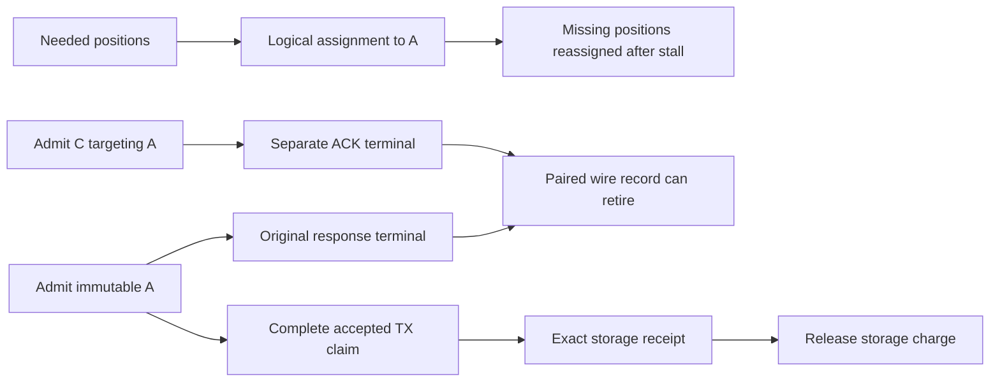

# Reviewing the atomic EB fetch implementation

This guide follows an endorsement block (EB) from an arrived offer to durable
acquisition, then explains the components which make that path safe under
stalling peers, cancellation, local reuse and shutdown. It describes the atomic
implementation in this branch, rather than the capped worker policy in the
simulator. “Atomic” means a source publishes a closure only after holding the
whole closure; the receiver still requests missing whole transactions in bounded
batches and can retain completed transactions across attempts.

The [cancellation contract][Contract] specifies the intended behavior. The
[MVP policy description][SimulatorPolicy] supplies the high-level policy and
simulator context. This guide connects those ideas to state owners, execution
boundaries and tests in the real implementation. Links identify files and exact
symbols; they do not depend on line numbers.

There are two reading paths:

- **Follow the data:** [orientation](#orientation), [one acquisition](#one-acquisition),
  then [disruptions](#disruptions). Use the component reference when a boundary
  needs a closer look.
- **Build up the model:** read the [component reference](#component-reference)
  in order, ending at runtime assembly, then use the [review index](#review-index)
  to connect invariants to contracts and tests.

## Vocabulary

These terms describe the fetch implementation's bookkeeping. They distinguish
what the node needs, what it has requested, and what it is responsible for storing.
Existing facilities such as the mempool and TxCache are described only where
their particular role in this path matters.

| Term | Meaning in this guide |
|---|---|
| Acquisition / obligation | The work still needed to obtain one EB's body and transactions. It can remain needed after an individual request fails. |
| Acquisition generation | One local incarnation of work for an EB point. Retiring and later restarting that acquisition uses a fresh generation, so captured atomic descriptors and storage claims cannot settle its replacement. Legacy receipts capture that generation later, at write submission. This is independent of a connection or session. |
| Peer lifetime / fetch session | Each peer registration gets its own lifetime, even on a reconnect to the same address; a session identifies one fetch mini-protocol invocation within that registration. |
| Wire ordinal / request key | The ordinal is a consecutive request sequence number within a session. A request key combines it with the peer lifetime and session, so callbacks also identify the right local incarnation of the connection. |
| Immutable request / descriptor | The request's EB, transaction positions and expected hashes/sizes stay fixed. Its descriptor is that validation checklist. Reassigning missing work does not change what an old reply must contain. |
| Assignment | Which peer is currently expected to fetch particular missing transactions. This scheduling decision is separate from whether an older request still owes a reply. |
| Admission / admitted work | Permission to proceed after checking and charging all required budgets. For local work, this can precede reading the transaction's bytes or queueing a DB copy; it does not mean the target already holds the TX. |
| Reservation | Capacity charged against a budget before work proceeds. It protects room for incoming or locally retained data without necessarily allocating that memory in advance. |
| Handoff / storage claim | The handoff is the bounded node-owned path from acceptance to storage. A claim tracks accepted bytes or a queued DB copy and their capacity owner while that storage work is outstanding. |
| Local reuse / import | Local reuse supplies this EB with a matching transaction already available in the node. An import queues mempool TX bytes; a guarded copy retrieves a TX from a stored EB. Neither needs a new peer download. |
| Queued copy descriptor | Instructions identifying source and target for a guarded DB copy. They retain metadata rather than TX payload, but still reserve the expected payload's capacity. |
| Useful delivery / service credit | Evidence that a peer supplied a needed, valid transaction for the first time in this acquisition. It adjusts retry patience; repeated copies and local reuse do not add that evidence. Resource budgets are accounted separately. |
| Receipt / held | A receipt reports the outcome of a real storage operation. Confirmed target positions are held; accepting bytes into the queue alone does not establish this. |
| Wire exchange / terminal / debt | An admitted request owes one FIFO response, ending at its terminal. A cancel has its own ACK exchange. These outstanding replies are wire debt even after the data is no longer wanted; settling an exchange accounts for its completion. |
| Source epoch | A change counter serving as a dirty signal: when it advances, the resolver checks local availability again. Comparing the counter across a scan detects changes during that scan without clearing a shared flag. It is separate from the acquisition generation. |

### What a reservation guarantees

Suppose a transaction batch's expected payload is 20 kB. Before requesting it,
the receiver charges 20 kB against its storage budget, along with the needed
object slots; encoded response bytes have a separate budget. Another request
cannot spend that capacity while it is promised to this batch. No payload need
have arrived or been allocated yet.

When the bytes are accepted, their charge follows the storage work. Finishing
or canceling the network request does not free capacity still occupied by
accepted work. It becomes available when that work completes or is safely
discarded before writing. Unused receive reservations can be released separately.
Local discovery follows the same principle: reserve before retaining bytes or
queueing a copy. The later [reservation-lifetime table](#reservation-lifetimes)
details each budget's scope and release boundary.

## Orientation

### Where to enter the code

Start at `withAtomicFetchApps` in [Network.NodeToNode.AtomicFetch][AtomicApps].
It validates transport/storage limits and brackets one runtime shared by all
connections. `atomicFetchApps` selects the negotiated client, server and ingress
limits together. This prevents an atomic client from running with the legacy
codec or an unrelated mux budget.

Next skim `withAtomicFetchNodeWithLocal` in [Atomic.Node][Runtime] to identify
the scopes it creates. Leave the large `decide` function until after the smaller
models: it composes their rules, rather than defining a single state machine
which replaces them.



Arrows distinguish the data path from feedback; they are not all thread
boundaries. The coordinator, local resolver and storage worker have separate
execution responsibilities. A connection also runs a client and a server; the
server is the mirror image of the receive path and is examined
[separately](#server-execution).

The source tree spans sublibraries and dependencies:

| Location | Responsibility |
|---|---|
| Consensus `MiniProtocol.LeiosFetch.Atomic` | Identity-dependent admission, deadlines, handoff, acquisition and recovery models; protocol and server state |
| Diffusion `MiniProtocol.LeiosFetch.Atomic` | Client, staged codec/receive adapter, local resolver and shared runtime |
| Diffusion `Network.NodeToNode.AtomicFetch` | Concrete transport selection and runtime assembly |
| Consensus mempool, `Leios.LocalStore`, TxCache and LeiosDB | Local discovery, bounded retention and durable storage |
| ouroboros-network and typed-protocols | Observed decoding, fatal wire guards, pipelined/lookahead execution and transport primitives |

### Three owners, several meanings of completion

An **acquisition obligation** describes what is still needed for an EB.
A **wire attempt** is one request to one peer. A **storage claim** tracks bytes
or a DB copy already accepted into the handoff. A local reservation is an earlier
stage: capacity has been secured, but the work has not necessarily been queued.

These responsibilities end at different times. Reassigning missing transactions
does not finish an older request, and a peer disconnecting does not dispose of
bytes the node has already accepted for storage.

`RequestKey` in [Identity][Identity] contains a peer registration/lifetime, a
fetch-session token and a `WireOrdinal`. A reconnect to the same address is not
the same lifetime. A new invocation is not the old session. The ordinal is a
`Word64` sequence number starting at zero; body, TX-batch and cancellation
requests share it. It is never reused or wrapped within that session. Acquisition
generations instead identify successive local attempts to acquire an EB point.
[Descriptors][Descriptor] capture the point, expected offsets, hashes,
sizes and original accounting so a late reply never follows a mutable pointer
to replacement work. See the contract on [identity][CIdentity] and
[obligations versus attempts][CObligation].

| Milestone | What is established | What is still owed |
|---|---|---|
| Offered | An arrived peer offer permits requesting that object | Actual bytes, validation and storage |
| Assigned/admitted | Logical ownership and the required resource reservations | Sending and receiving the immutable request |
| Verified and useful | A complete object matches its descriptor and newly contributes useful data | Wire termination and/or durable storage |
| Pending storage | Accepted payload belongs to the node-owned handoff | Its storage receipt; the peer may already be gone |
| Wire terminal | The original typed response is finished | Any separately issued cancel ACK and outstanding storage claims |
| Durable/held | Storage confirms the target body/TX positions | Remaining positions, if any |
| Publicly acquired | Durable body/closure conditions justify the notification | Independent draining wire work may still remain |

A valid transaction can help the download without proving it is already stored.
The policy records helpful service when a peer first delivers a needed, verified
transaction; this evidence reduces extra retry allowances built up after stalls.
Receiving another copy adds no new evidence, and finding the transaction locally
needs no peer
delivery. Storage confirmation remains a separate step. In particular, queueing
instructions to copy a transaction is a promise of work still to perform, not
confirmation that the target EB already holds it.

### The four local objects

The **mempool** holds validated transactions and an optional index keyed by the
exact hash/size used in EB serialization. That serialization includes witnesses
and validity data; the ordinary transaction ID is not enough.

**TxCache** is a bounded memory-only discovery service for compact references
and optimistic durable source locations. It does not hold a resumable EB-body
prefix, and a hit does not prove that the target EB has the transaction.

The **handoff** owns reservations, queued/writing payloads and copy claims. It
keeps the receive path from waiting for a DB commit while bounding what it can
retain. **LeiosDB** is the durable store which can confirm target possession or
perform a guarded copy from another stored EB. A transaction can remain there
after disappearing from the mempool or the bounded cache index.

## One acquisition

Consider an illustrative five-transaction EB. `tx0` is available in the mempool,
`tx1` has a cached durable source, and `tx2..tx4` are absent locally. Give the last
three sizes which fit the checkpoint shown. One upstream supplies the body and
an arrived full-closure offer. This scenario combines independently tested paths;
there is no claim that one existing test uses exactly this five-TX mixture.

### 1. Acquire the independent body

An EB body offer does not imply the peer holds the closure. The runtime admits
a whole-body request with immutable context, a response reservation and handoff
capacity. Admission uses the applicable trusted body upper bound, so a valid body
can still be accepted when its offer understated the size. The timer uses the
offered size instead; **reservation size and patience size have different jobs**.

The codec obtains a complete body, validation checks it, and `Handoff.acceptBody`
makes verified references available while accepted body storage proceeds. A
verified winner can stop redundant body policy work before its durable receipt.
A valid understated body is retained even if its supplier is subsequently
disconnected for the misstatement; `Node.atomicMisstatement` and
`Node.bodyNewAlternative` in [node tests][NodeTests] protect this ordering.

The ordinary runtime currently waits for `snapshotBodyDurable` before calling
`fill` in `Atomic.Node.decide`. Local reservation requires durability too. The
lower-level checkpoint API is more permissive: `Acquisition.testBodyReadiness`
in [acquisition tests][AcquisitionTests] constructs work from verified references
before durability, while legacy projection remains `NoBody`. That test does not
describe the ordinary node's dispatch gate. The walkthrough follows the runtime
gate without assigning an undocumented rationale to the stronger restriction.

### 2. Discover and reserve local work

After the body receipt, the resolver inspects the missing positions. In
`resolveLocalSlice`, [LocalReuse][LocalReuse] first classifies exact mempool hits,
then asks TxCache about the other positions. It publishes bounded scalar
classifications to the handoff; it does not pass a retained mempool snapshot to
the wire planner.

For `tx0`, reservation and a fresh mempool-index check happen in the same STM
transaction. Only then does the resolver retain the chosen TX, construct its
exact EB bytes outside STM, and queue them for storage. For `tx1`, it reserves
the expected payload size and queues instructions for the DB to copy and check
the transaction. Those instructions are the copy descriptor: they retain source
and target metadata, rather than payload. Charging the full expected size keeps
this cheaper representation from bypassing local byte limits.

The resolver classifies `tx2..tx4` as real misses. Known local candidates defer
when the local pool is full; an actual miss can proceed to the network. Local
work uses a separate node-wide pool, so it cannot consume receive space already
promised to a peer. Rechecks and failed copies can change these classifications
later; a hint alone never marks a target held.

### 3. Admit immutable checkpoints and pipeline them

`assignCheckpoint` in [Acquisition][Acquisition] selects eligible, missing,
unowned positions, constructs a whole-TX batch and admits it transactionally.
The checkpoint target is soft: a final whole transaction may cross it, within
independent entry, payload and encoded-response limits. This is not a request
for a publication chunk or an arbitrary byte interval.

In this example the first eligible source can receive all three network misses.
With a larger missing set, `Atomic.Node.fill` can admit several disjoint batches
to the same peer while budgets permit, hiding subsequent request latency. Atomic
has no fixed capped-worker count. Other arrived closure suppliers become useful
for newly unassigned work or recovery; concurrent sourcing does not imply that
ordinary assignments duplicate the same positions.

`C.admitClientRequest` publishes the descriptor, timing context, handoff reservation
and sender work coherently. Failure consumes neither a partial assignment nor a
wire identity. A queued checkpoint has not yet used up its FIFO-head service
allowance.

### 4. Accept complete TXs without waiting for the whole response

The [codec][Codec] emits complete-element progress while it decodes the batch.
[Receive][Receive] checks each transaction against the captured offset/hash/size,
then transfers accepted payload to the bounded handoff. Partial bytes of a TX
are not a reusable transaction.

`Handoff.acceptTx` updates acceptance and returns `Useful` only for newly useful
service. The client hook in `Atomic.Node` then calls `noteClosureService`; this
evidence precedes the DB receipt. Verified-pending positions are transactions
whose bytes have checked out and are waiting for storage; recovery excludes
them from its missing set. If storage does not confirm an accepted TX and it
must be fetched again, its second delivery does not earn service credit again.
Neither do duplicates or locally supplied transactions.

### 5. Settle wire and storage independently

```mermaid
sequenceDiagram
    participant P as Upstream
    participant C as Client / receive
    participant R as Local resolver
    participant H as Handoff / storage worker
    participant D as LeiosDB
    participant K as Coordinator
    P->>C: Complete EB body
    C->>H: Verified body and references
    H->>D: Write body, await receipt
    D-->>H: Body durable
    H-->>K: BodyDurable, readiness
    K-->>R: Relevant missing positions
    R->>H: Reserved tx0 bytes and tx1 copy claim
    R-->>K: tx2..tx4 are network misses
    K->>C: Admit immutable checkpoint
    C->>P: Request tx2..tx4
    P->>C: Complete TX elements
    C->>H: Verified payload; useful acceptance
    C-->>K: Useful-service observation
    P->>C: Original response terminal
    C-->>K: Wire exchange settled
    H->>D: Write/copy pending transactions
    D-->>H: Exact durable receipts
    H-->>K: ClosureDurable
    K-->>K: Publish acquired closure
```

The sequence chooses one ordering to expose the boundaries. Local writes and
network reception can overlap, and some storage receipts can precede the wire
terminal.

`Receive.finish`/`Client.finishReceiver` settle the original FIFO response and
its remaining response reservation. If a cancel was issued, its ACK remains a
separate exchange. The storage worker awaits real receipts, reconciles exact
claims, updates held positions and returns the associated storage capacity.
`Atomic.Node.storageEvent` emits `AcquiredEb` from `BodyDurable` and
`AcquiredEbTxs` from `ClosureDurable`. A successful enqueue or a completed wire
message cannot substitute for these receipts.

The integration fixture `Node.atomicLocalCache` supplies three cached TXs, one
or none: its assertions are respectively one body plus zero, two or three TX
requests. The deliberately small fixture checkpoint size makes those dispatch
differences visible. It also proves that all-local acquisition can finish from a
body-only offer. Read it in [node tests][NodeTests], then the contract on
[incremental reception][CReceive] and [durable acquisition][CDurable].

## Component reference

Read these sections in order for the bottom-up route. Each identifies the owner,
the important transitions and the places where a change needs more than a local
check.

### Identity and admission

[Identity][Identity] defines lifetimes and request keys;
[Descriptor][Descriptor] freezes the expected response;
[Admission][Admission] is the pure connection-wide ledger. The client/handoff
apply its transitions in STM. Admission itself does no sending or storage IO.

The immutable descriptor matters after the request is unwanted: a late response
still belongs to the original batch, with its original validation and charges.
Reassigning missing offsets changes logical ownership, not the meaning of old
bytes. This is the [late-reply contract][CLate].

`admitData` reserves more than a sender queue slot. It accounts for the data
record, encoded response, payload/element handoff capacity and a future cancel.
`admitCancel` creates another ordinal and FIFO exchange targeting that original.
A full data pipeline must still have control headroom to cancel it. New admission
near ordinal exhaustion must also preserve that promise.

`finishHead` settles only the exchange at the FIFO head. A normal reply crossing
a cancel does not settle the ACK as well. The original data record can remain
paired to the ACK after its own response is done. `releaseHandoff` is a separate
operation for accepted object ownership; disconnect cannot pretend those bytes
never arrived.

Review `testFIFO`, `testCapacity` and `testExhaustion` in
[admission tests][AdmissionTests] together. They protect control headroom, paired
debt and finite identities. `AtomicClient.testPublicationRollback` checks that
failed publication does not leak a reservation/ordinal. `propTransitions` explores
generated ledger traces; it is not a concurrency proof. Contract:
[FIFO][CFIFO], [bounded request window][CBounds] and [admission/lifecycle][CLifecycle].

### Timing and wakeups

[Deadline][Deadline] constructs immutable timing inputs; [Timing][Timing] owns
their observation/activation state; [Wait][Wait] reconciles readiness and absolute
deadlines. They deliberately distinguish sending, receipt and local handling.

At admission, `snapshotTiming` freezes the payload, conservative RTT, service
benchmark and backoff. At FIFO-head activation, `dataDeadline` supplies the
actual head time and whether the receiver observed a continuous data pipeline.
A queued request does not spend its service allowance waiting behind another
reply. A cancel ACK has its own head-only soft guard.

A fast peer can reply before the local send operation reports return. A timely
terminal can be validated after its deadline when its validation boundary was
published before expiry handling. Timing reconciles those observations by their
recorded times and identity. Partial progress or a new RTT sample does not renew
a fixed request deadline. A stale timer or validation token cannot affect a new
head/session.

The driver installs input-publication protection before taking a fresh nonempty
read's timestamp. The input callback publishes that original time under the
same token. When a completed frame leaves buffered input, its completion hook
publishes that fact before typed settlement can activate the next FIFO head.
Starting the successor atomically replaces it with the successor's own step.
This covers both timestamp-publication and buffered-head transition gaps.

Protection lasts only for bounded local work. A decoder needing more input
releases it before waiting, so a silent or partial peer still reaches the same
deadline. Known-late input does not gain patience; abort clears the exact session.
A timer's handling time distinguishes a missed older observation from a reply
which arrives afterward at the same clock value: the latter can settle while
the already charged failure stands. Neither timestamps nor deadlines move.

Read `testPublicationGap`, `testBufferedTransition`, `testPublicationAbort` and
`testPartialInputWait` in [client tests][AtomicClientTests], and the publication,
buffered-input and equal-time cases in [timing tests][TimingTests]. These gates
force the problematic schedules through the real client/codec/driver. They
assume production callbacks remain bounded; they do not prove scheduler fairness.

`waitForWakeup` consumes a coalesced readiness bit and/or a registered nearest
deadline. A notification during planning must remain visible for the next pass.
The coordinator still checks due deadlines on a readiness wake, so flooding
readiness cannot postpone a trigger indefinitely. Legacy scheduling retains its
separate half-second gate even when atomic policy reacts promptly.

Start with `Timing.testFastReply`, `testValidation`, `testPartial` and
`testNoRenewal` in [timing tests][TimingTests]. Then inspect
`Wait.testDuringPlanning` and `testFlood` in [wait tests][WaitTests] and the node
readiness-flood fixture. These controlled schedules explain observation rules;
they do not establish actual socket timestamp precision. Contract:
[activation][CActivation], [wakeups][CWake], [ACK guard][CAck]. The exact timing
calculation is in the [appendix](#timing-and-current-defaults).

### Handoff and durable storage

[Handoff][Handoff] owns accepted storage independently of a connection. Its
`StorageSession` fixes the peer lifetime and session; its claims also identify
the acquisition generation. A reconnect can drain old accepted work while a
replacement session exists, but cannot reset the stable owner's storage charge.

Network admission reserves space before dispatch. `acceptBody`/`acceptTx` transfer
complete validated objects to node ownership. Local work uses
`reserveLocalTransaction` and either `commitLocalTransaction` or `commitLocalCopy`.
Uncommitted local reservations can be dropped; committed payload/copy claims
remain charged until their exact settlement. The worker here is a **storage
worker**, not a capped-policy network worker.

The worker coalesces already-ready whole TX work up to its own target, submits
writes/copies and awaits [LeiosDB receipts][DB]. Pending verified bytes suppress
new requests without being projected as durably held. Failed or unconfirmed
positions may become fetchable again. The receipt must name the claim which
actually owns the work: a late old-generation completion cannot directly settle
a replacement claim.

`readStorageRequestComplete` has a narrower purpose. It reads how many original
response elements were accepted, including duplicates. It releases nothing and
does not mean “durable” or “earned service.” Its cancellation guard is explained
in [the delayed-callback story](#complete-payload-before-terminal-callback).

In [storage tests][StorageTests], `test_receiptCommitBarrier` holds a real SQLite
commit boundary and checks that the receipt has not completed early;
`test_receiptCommitFailure` checks that a failed commit does not become success.
Copy receipts have parallel tests. [Handoff tests][HandoffTests] exercise local
and network contenders, exact refunds, stale generations and disconnect during
writing. These are the checks behind the contract's
[durable-acquisition boundary][CDurable].

### Local discovery, reuse and cache publication

[LocalReuse][LocalReuse] is a bounded resolver separate from the wire planner
and DB-awaiting worker. `runLocalResolver` fairly revisits relevant acquisitions;
`resolveLocalSlice` classifies a bounded slice and reserves before retaining
local material. A full local pool defers a known candidate, while true misses
remain network-eligible. This avoids treating temporary local pressure as an
excuse to download everything again.

The mempool's exact-byte index and its epoch belong to the protected mempool
state. Removal-only changes must advance that epoch too. If a masked state owner
is interrupted, restoring the transaction state without restoring its matching
index/epoch could leave false hits or a sleeping reader. The [mempool tests][MempoolTests]
exercise the exact EB-byte hash, insertion/removal, revalidation and protected
state restoration together.

Constructing the exact EB-serialized bytes (called projection in the local-source
API) happens outside STM because it may do work and must not hold the coordinator
lock. Reservation plus source recheck happens first, under masking;
cleanup drops an uncommitted reservation even if projection is interrupted.
Wrong-size metadata is rejected before projecting potentially large bytes. The
resolver does not keep a lazy map which pins the whole mempool between turns.

[TxCache.API][TxCache] separates compact body references from source hints.
`lookupLocations` returns a revision with its locations; `cacheSourceEpoch` is
readable without acquiring the cache's IO lock. A cached source can disappear,
be replaced or be pruned. The DB's guarded copy checks the actual expected
hash/size and target before confirming presence.

`observeLeiosDB` in [LocalStore][LocalStore] decorates real receipt awaits:
confirmed body references and TX locations are published only after the backend
confirms them. Install that observed handle before ChainDB/NodeKernel consumers
receive it, as [Node assembly][NodeAssembly] does. Wrapping only the atomic
client's writer would miss legacy fetch, forged writes and GC. The decorator
does not create a supervisor: callers must still await accepted writes after a
peer/caller exits.

Cache publication is a global durable source fact. Claim settlement is specific
to an acquisition generation. Thus an old accepted write can publish a valid
source location without directly completing a newer acquisition. GC first
advances the cache frontier and releases its lock, then invokes the raw DB GC.
Late publication below that frontier is ignored, and conditional invalidation
cannot erase a newer location.

Read LocalReuse tests “R02 cache change after lookup is not swallowed at pass
completion,” “R10 GC releases the cache lock before invoking database GC,” and
“R14 closing escapes an unavailable source STM condition” in
[local-reuse tests][LocalReuseTests]. These review-gap tests explain wake/lock
placement, rather than each proving a historical production incident.
[Cache model tests][CacheTests] compare reference and optimized implementations;
[forge tests][ForgeTests] check a writer outside fetch. The
[immutable-source story](#immutable-source-hidden-by-a-placeholder) shows why
discovery and payload retrieval must agree.

### Assignment and recovery policy

[Acquisition][Acquisition] owns ordinary disjoint assignments. Its checkpoint
builder uses verified references and the actual TX sizes. Target, protocol hard
limits and source availability are different constraints. A short final batch
can be under target; an overhanging final TX cannot exceed the hard bounds.

A tail transfer moves still-needed later batches from a blocked source to a
productive replacement source. `assignCheckpoint` and tail-transfer admission
run transactionally with ownership changes. A failed admission must roll back releasing the old tail. A successful
transfer changes who should do useful future work; it does not rewrite the old
wire descriptor. `testAdmissionRollback`/`testTailTransfer` in
[acquisition tests][AcquisitionTests] check those consequences, including old
release not undoing replacement ownership.

Body, Closure and Retry are pure policy models. The runtime applies their plans
with admission in STM; a rejected admission leaves work unpublished for a later
pass rather than waiting for a peer inside the planner.

[Body][Body] retains its primary after the trigger and allows one wanted rotating
hedge per EB. Alternatives are maintained in first-offer round-robin order.
Same-EB unresolved original/ACK debt excludes a peer from immediate reuse.
A verified whole-body winner can come from a late primary or a retiring hedge;
losers become unwanted but still drain their wire obligations. There is no
reusable partial-body payload.

[Closure][Closure] retains an expired ordinary primary and makes its still-needed
positions rescuable. Each EB has one wanted additional rescue batch, shared among
its stalled ordinary obligations; no TX has more than two wanted new-policy
copies. Draining canceled originals still owe their separate wire debt.
An expired rescue is withdrawn and rotated. A partly useful original keeps its
original response meaning; recovery selects only what remains missing. Productive rescue sources can take over a blocked source's
later queued work by transactional tail transfer. Eligibility also checks which
positions the local resolver has classified as network-fetchable; a known local
candidate waiting for capacity is not automatically a network miss.

The runtime ranks ordinary closure candidates by failure count, actual closure
offer arrival time and stable lifetime tie-break. Recovery uses its own eligible
candidate rules and available wire slots. Availability must come from the same
captured offer snapshot as the pass, not only a timestamp in another cell.
See [the offer-snapshot story](#offer-times-and-offer-authority).

[Retry][Retry] owns closure retry pressure and grouped cooldown **per EB**.
New rescues snapshot their multiplier; ordinary requests retain factor one.
An actual still-wanted rescue expiry increases pressure. Uniquely useful bytes
reduce it in proportion to the nominal checkpoint target, rather than resetting
everything on a tiny success. Primary triggers, stale callbacks and ACK expiry
are not extra rescue failures. Cooldown gates new rescues, not retained originals,
ordinary work, body recovery or another EB. Body backoff is separate and has no
useful-byte decay. Selection failure counts are separate again: Closure keeps
them per live peer registration across EBs. Useful service reduces an EB's retry
pressure; it does not erase that cumulative selection history.

Read `Node.closureRecovery`, `closureRescueRotation`, `closureRetryCycles` and
`closureCooldownIndependent` in [node tests][NodeTests] after the small
[body][BodyTests], [closure][ClosureTests] and [retry][RetryTests] models.
Contract: [deadline reactions][CTiming], [unfinished replies][CStall] and
[partly redundant batches][CPartial].

### Client, codec and receive adapter

[Client][Client] owns one mini-protocol invocation and its immutable FIFO
contexts. Its public admission/cancellation operations compose handoff and timing
transitions with sender publication. The interpreter sends admitted work and
receives each result against the captured descriptor. Old callbacks cannot look
up “whatever request this peer currently owns.”

[Codec][Codec] incrementally exposes complete transaction elements while retaining
normal CBOR framing and typed terminals. [Receive][Receive] connects those
observations to exact validation and handoff. The body is a whole object; a batch
can have a useful complete-TX prefix before its remaining framing is available.
Concrete canceled results are `MsgBlockCancelled` and `MsgBlockTxsCancelled`.

The network progress machinery records byte spans/input observations scoped to
the decoder. One physical `recv` chunk can split or span protocol messages. Its
arrival alone neither completes a TX nor proves the next reply finished.
`decodeWithByteSpan` from `Ouroboros.Network.Protocol.Codec.Utils` supplies the
existing `WithByteSpan` representation for each decoded TX. Annotated decoding
and immutable contexts join those spans to actual element and terminal boundaries.
Trailing input keeps its original read-observation time across reply boundaries;
restamping it when the next decoder starts would change the apparent event order.
Raw mux tracing is not the acquisition authority.

`newReplyReceiver` pins a receive scope before parsing. Scope acquisition installs
abort ownership before input can invoke callbacks; synchronous masked callbacks
must be bounded and must not wait for storage. The driver owns abort notification
while it runs. Typed settlement handles its own failure after the driver returns,
which explains why terminal settlement is separate from decode-time element
handoff. Already accepted elements survive either later failure.

`testStreaming` and `testMalformedTail` in [receive tests][AtomicReceiveTests]
show a valid prefix entering the handoff before the rest of the response and
surviving malformed later input. That prefix remains pending/charged, rather
than becoming durable by fiat. `testObsolete` checks that valid old-generation
data does not satisfy replacement work. `testPartialCancel` in
[client tests][AtomicClientTests] connects accepted prefix, original terminal and
ACK debt; [codec tests][AtomicCodecTests] cover framing and bounds. Contract:
[progress descriptors][CProgress] and [single-message reception][CReceive].

### Server execution

[Server.State][ServerState] owns bounded request/control records, preparation
charges and the reply commit decision. [Server][Server] executes it using
lookahead: intake can accept cancellation while a separate preparation operation
or FIFO output is pending. Lookahead permits receiving ahead; it does not reorder
the protocol's replies.

Preparation borrows one DB reader. If cancellation wins, interrupt **and join**
that operation before reusing the reader. `commitDataReply` is the atomic choice
between normal and canceled original result. If normal already committed, the
whole response drains intact, then the separately ordered cancel ACK follows.
Canceling A does not cancel independently requested B.

The prepared/sending payload is charged independently of request slots. Some
slots can retire at commitment while the payload remains owned through send
return, so a fast client can legally send replacement work without making the
old payload unaccounted. `FlushSender` also appears on normal intake: it reaps
completed framework sender work and its type witness/counter. Bounding application
maps alone would not bound that interpreter bookkeeping.

`testCancelPreparing`, `testCanceledLateResult` and `testCancelCommitted` in
[server tests][AtomicServerTests] separate these phases. The first waits for
preparation's bracket finalizer before allowing another use of the reader.
The late-result test catches cancellation in a blocked callback, returns a normal
fixture value anyway, and checks that cancellation still wins. Its helper views
`MsgBlockCancelled` as `Left ()`; that is not a refusal message. It demonstrates
late-result rejection and cleanup for that schedule, not prompt interruptibility
of every foreign storage operation. Contract: [commit point][CCommit] and
[FIFO][CFIFO].

### Runtime, assembly and compatibility

Return to `Atomic.Node.decide`, `driveBodies` and `driveClosure` in
[Atomic.Node][Runtime]. They reconcile durable acquisition snapshots, policy
attempts, ordinary assignments and client ledgers under the fetch kernel's
outstanding-state lock. The resolver, validation and DB IO do not run inside
that lock. `nextPolicyDeadline`/the extension's deadline query are observational;
the coordinator performs mutations after it wakes and takes the lock.

The lock also serializes request publication with peer removal. Otherwise a peer
could disappear between selection and publishing work which no live client will
send or clean up. Invocation/session tokens protect against a different race:
an old finalizer must not remove replacement state, even when both refer to the
same peer registration.

Acquisition metadata has its own cap. An announcement with no body offer can
occupy a cheap empty acquisition; when offered work needs room, the runtime can
reclaim an empty acquisition entry with no offer. It preserves verified metadata, wanted bodies
and outstanding legacy body work. `atomicReclaimsEmpty`, `atomicPreservesWanted`
and `atomicPreservesAccepted` in [node tests][NodeTests] distinguish reclamation
from evicting useful acquisition state merely to make space.

Current negotiation selects the atomic path for version 17 with the negotiated
positive count; version 16 retains the legacy path. Generic/identity-codec
assembly retains its explicit legacy guard. Concrete-byte normal assembly uses
`atomicFetchApps`, rather than silently putting the legacy codec on a version-17
connection. The [contract follow-ups][CFollowups] record the intended later move
of this experimental split into version 16; that is not the current code.

The legacy bridge has its own wire jobs/quotas but shares durable acquisition
truth. New legacy scheduling waits for a live shared acquisition generation:
shared storage events own its public notifications, so requests must not bypass
that metadata-capacity gate. Existing queued/in-flight work still drains.
Legacy jobs do not pin a generation when the request is admitted. The receipt
bridge captures it at write submission. A response submitted only after synthetic
refocus may therefore supply verified same-point data to the new acquisition;
an already-submitted old receipt remains fenced from its replacement. Atomic
descriptors capture their generation earlier, at admission. `testOldLegacyReceipt`
in [handoff tests][HandoffTests] checks the captured-receipt boundary.

Low-level installation rejects unfinished legacy `BodyAcquired` jobs before
publishing an extension: a fresh handoff has no reference metadata for them.
Announcements-only state and completed/empty startup seeds are accepted. Read
`atomicRejectsIncompleteInstall` and `atomicAcceptsInitialSeeds` in
[node tests][NodeTests] for rejection, rollback and clean-retry coverage.

Real receipts can satisfy either path and avoid duplicate public notifications. The old whole-vector receive path is not the new incremental
prefix path. Legacy receipt supervisors remain node-owned after the requesting
caller exits, so an observed write can still publish its source and settle.

Read `coordinatorClientCleanup`, `coordinatorReconnectStorage`,
`coordinatorShutdownStorage`, `atomicMixed` and `atomicLegacyCacheAfterExit` in
[node tests][NodeTests]. `coordinatorFocusRefocus` deliberately changes focus
through a lifecycle seam while a write is held; `focusCertifiedEb` in
[Decision][Decision] has no production caller in this snapshot. The test establishes
safe generation fencing, not an ordinary production certificate transition.
Contract: [integration][CIntegration] and [shutdown/compatibility][CLifecycle].

## Disruptions

These cases change one condition in the acquisition story. The tests explain
which ordering is protected; their scope matters as much as their names.

### A stalled primary and a blocked FIFO

Suppose the ordinary source delivers a few complete TXs and stops. Its one
trigger makes the remaining positions rescuable, but keeps receiving from the
primary. If it resumes, its complete TXs can still win. The EB's single wanted
extra rescue slot is shared among its stalled obligations; an expired rescue is
canceled and rotated while the persistent original remains.

There is a second way work can become stranded: EB X's data response is stuck
at a connection's head, and EB Y's body request is queued behind it. Y's own
service clock has not started. Waiting for Y's expiry would never help. The
fired data/ACK head instead enables recovery of queued work without pretending
Y served badly or starting Y's clock early. Recovery still needs an eligible
alternative and real admission capacity.

`Node.bodyBehindTransactions` exercises exactly that blocked-body case;
`bodyConcurrentEbs` checks independent per-EB hedge slots despite one blocked
connection. `closureRecovery` checks retained prefix and missing-only rescue.
They are in [node tests][NodeTests]. See [unfinished-reply liveness][CStall] and
the [ACK-head guard][CAck]. A fatal protocol timeout remains the connection's
last-resort guard; it is not the normal policy trigger.

### Complete payload before terminal callback

The receive adapter can accept the last valid element before the client runs
its typed terminal callback. A coordinator using only that later callback would
still see an apparently unfinished attempt and issue a needless cancel.



The integration regression `Node.closureSoleSource` delays the first TX response
past its trigger, then supplies the transactions. It asserts a stored closure,
one stall, no rescue and no cancellation. The repair is the check of
`Handoff.readStorageRequestComplete` inside `Atomic.Node.driveClosure`'s `settle`,
in the same STM transaction as proposed cancellation admission.

This is a recorded integration discovery, not an invented rationale from the
function's name. The count includes accepted duplicates, releases no capacity,
and is neither a useful-service score nor a durable predicate. Read
[the node fixture][NodeTests] and [the guard][Runtime] together; the fixture
demonstrates its controlled reachable schedule, not all pipelining interleavings.

### Offer times and offer authority

Peer A offers the body early. Peer B offers the closure before A later does.
A's body timestamp must not give it priority over B for closure work.
`Node.atomicOfferOrder` in [node tests][NodeTests] makes that distinction visible.

There is a subtler cross-snapshot failure. The coordinator can have captured a
body-only `PeerOffer`, then read separately updated arrival-time metadata which
already contains a closure time. Both observations are valid, but they do not
authorize the same request. Faster coordinator integration exposed this mismatch
through existing recovery tests.

`closureCandidates` inside `Atomic.Node.decide` requires both the actual closure
half of the captured offer and its closure-arrival timestamp. A timestamp ranks
eligible suppliers; it cannot turn an unavailable object into an offer.
`atomicOfferOrder` is adjacent integration evidence for correct ordering, not
a claim that this one test originally exposed every snapshot race.

### Cancellation before and after commitment

Consider original requests A, B, then cancel C targeting A. Replies remain
ordered by these exchanges; the control does not jump over B.

| When cancellation wins | Original A | Independently requested B | Control C |
|---|---|---|---|
| Before A's reply commit | A's canceled terminal, after preparation unwinds | Its own reply still follows | Its ACK follows at C's position |
| After A's normal reply commit | A's entire normal response drains | Its own reply still follows | Its ACK follows at C's position |

The server may receive C while preparing/sending A because intake uses lookahead.
It cannot safely reuse A's borrowed reader until preparation actually exits.
An interrupt request alone is not proof of exit. The client cannot release
accepted storage merely because A became unwanted.



The three paths above have different lifetimes. Reassignment does not itself
settle either physical exchange or accepted storage. Read
`AtomicServer.testCancelPreparing/testCancelCommitted` and
`AtomicClient.testPartialCancel` alongside [the commit contract][CCommit] and
[FIFO contract][CFIFO]. The server late-result fixture also checks that a normal
result returned after cancellation is discarded, rather than sent as a second
outcome.

### Immutable source hidden by a placeholder

A source EB is promoted to immutable storage and its volatile rows are collected.
A late duplicate body then recreates empty volatile rows. If reference lookup
and byte loading disagree about which representation is authoritative, a valid
cached immutable source can appear to have no payload.

`test_localCopyImmutable` in [storage tests][StorageTests] exercises promotion,
GC, the late placeholder and a guarded copy on both backends. It also checks
that an already-held immutable target can be confirmed even after the advertised
source disappears. The SQLite repair requires both reference selection and
`sourcePayload` in [SQLite.Insert][SQLiteCopy] to reach complete immutable data;
changing metadata lookup alone is insufficient.

This was a discovered storage regression. The ordinary batch reader has related
fallback tests, but it is a distinct path; this fixture does not prove every
mixed volatile/immutable read arrangement. A failed target match also does not
automatically prove that a cached source is corrupt. Cache invalidation names
the old location conditionally, preserving a newer replacement hint.

### Source changes and blocked shutdown

A full local pool is a reason to park a known candidate, not to stop observing
the source. If the mempool removes that transaction, the source epoch alone must
make it eligible as a network miss. Likewise, an invalidation between cache
lookup and resolver sleep must not be acknowledged without another pass.
`runLocalResolver` captures epochs at pass start for this reason.

LocalReuse tests R01 and R02 create those two schedules. R11 also checks that
unchanged full capacity parks rather than spinning, and that unrelated source
churn cannot starve another acquisition's network misses. R14 makes a source
STM action unavailable, then closes the runtime: the closing alternative must
enable exit without waiting for a source condition whose producer may be gone.
Read [these tests][LocalReuseTests] as deliberate review-gap coverage.

`withAtomicFetchNodeWithLocal` provides nested scope ownership rather than one
universal linear shutdown list. Its action owns and joins connections. Cleanup
sets closing and wakes both planner and resolver; accepted legacy receipts keep
their supervisors, and local resolver completion is joined within the scope.
The enclosing handoff scope drains accepted storage. Only then does uninstall
project final durable truth and remove the extension before the DB scope ends.
Resolver exit can occur while legacy receipts drain; do not infer a stronger
ordering than the brackets impose. Storage/resolver failures propagate to the
owner instead of silently leaving shutdown waiting on an abandoned claim.

Forged writes have a separate owner: `storeForgedEb` registers its receipt
waiter with the node resource registry. Normal receipt completion publishes
cache facts and body/closure notifications; registry shutdown cancels and joins
the waiter before its owning scope ends. A raw database flush only drains
accepted writes and does not itself join those later callbacks. Shutdown may
therefore suppress a pending forge notification while retaining committed data.
The forge receipt-ownership regression in [forge tests][ForgeTests] gates that
waiter and checks both join and persistence.

## Relationships across components

The import graph does not show these causal edges. Use this table when changing
one end of a relationship, then follow its component section and test evidence.

| Producer/change | Published fact or wakeup | Distant consumer and guard | Why placement matters |
|---|---|---|---|
| Receive accepts final element | Admission observed-element count, atomically with acceptance | Coordinator reads exact completeness before admitting cancel | Terminal callback delivery may lag; a callback-only fix retains the race |
| Real storage receipt completes | Held positions, exact claim settlement and durable events | Planner, local resolver, public notifications and capacity waiters | Enqueue/validation cannot announce durable acquisition; accepted storage outlives a peer |
| Mempool source is removed | Protected source epoch | Resolver reclassifies a deferred candidate | No new offer or capacity release is required to turn it into a miss |
| Cache changes after a lookup | Cache epoch compared with start-of-pass observation | Resolver performs another bounded pass | A pass cannot acknowledge a change it did not process |
| Legacy/forge/fetch writer commits | Observed DB publishes confirmed locations | Later acquisitions discover a local source | Decorating only one fetch writer leaves other producers invisible |
| GC advances / old copy fails | Monotone frontier / conditional location invalidation | Cache rejects late old publications and preserves newer hints | Cache locks must be released before DB callbacks; old failures cannot erase new facts |
| Peer removal or invocation replacement | Outstanding-lock serialization and captured identities | Admission/cleanup acts only on the selected lifetime/session | No stranded publication after removal; no old finalizer closes replacement work |
| FIFO terminal received | Head transition with observation time | Timing activates the next request and classifies its pipeline | Planner time and handler delay do not define service start |
| Cancel received during preparation | Server state and worker interruption | Preparation join precedes reader reuse; commit checks winner | Intake responsiveness alone does not make borrowed resources safe |
| Runtime closes / storage fails | Independent closing/failure escape | Resolver, receipt supervisors and scope joins | A child cannot require a peer/source event which will never occur |

Global cache publication and generation-specific acquisition settlement deserve
separate review even when triggered by the same receipt. A durable old write can
be a legitimate future source while its original acquisition is no longer
relevant. Conversely, discovering that source does not entitle the new acquisition
to skip its own guarded claim and receipt.

## Resource and liveness review

### Reservation lifetimes

These are overlapping bounds on different objects, not interchangeable names
for one queue size. Source details are in [Admission][Admission],
[Handoff][Handoff], [Server.State][ServerState], [transport limits][Transport]
and [TxCache][TxCache].

| Resource / scope | Reserved or owned when | Release boundary | Effect of disconnect |
|---|---|---|---|
| Per-session data records and cancel headroom | Admitting a data request and its possible control | Original and any admitted ACK settle according to paired-record rules | Retire unreceived wire work; do not alias a replacement session |
| Per-connection encoded response budget | Before dispatch, shared across EBs and request kinds | Reception/terminal settlement of that response | Retire the old response debt; accepted payload has separate ownership |
| Payload bytes/object slots per stable upstream owner | Before network dispatch; accepted objects become handoff tickets | Unused reservation released by terminal/session retirement; accepted claim by exact storage settlement | Accepted queued/writing data stays charged, including draining reconnects |
| Node-wide local bytes/entries | Before retaining projected bytes or enqueueing a copy descriptor | Uncommitted drop, or committed exact settlement | Not owned by the requesting peer |
| Acquisition metadata | Beginning a relevant point/generation | Retirement/pruning or reclaiming an eligible empty entry | Kept or retired according to relevance, not arbitrary address reuse |
| Server prepared/sending bytes and borrowed reader | Before preparation; adjusted to actual bounded response | Preparation unwind and send-return for their respective owners | Interpreter cleanup joins its operation before resource reuse |
| Mux/progress input buffers | Sized from negotiated count and runtime response budget | Transport/decoder consumption and scope cleanup | Connection-scoped; not a substitute for storage admission |
| Cache table, references and source ring | Runtime cache allocation and bounded tracked announcements | Eviction/pruning or runtime close | Global to the node; no peer attempt history is retained |

A larger wire budget cannot fix a full handoff pool, and canceling policy interest
cannot immediately recycle a buffer still owned by decoding, sending or storage.
A logically empty queue therefore does not establish zero resource use.

The cache's default arrays alone occupy about 160.5 MiB, excluding compact
references/metadata. A 1 MiB handoff budget is not a whole-node memory bound.
Legacy whole vectors, transport ingress and server output add other owners.
The cache starts empty after restart; it is not a persistent source catalogue.

### Waits, producers and escapes

| Wait / blocking boundary | What normally enables it | Failure/closing rule to inspect |
|---|---|---|
| Coordinator readiness / nearest deadline | Offers, client observations, durable events, local classification or timer | Due deadlines checked on all wakes; legacy cadence kept independent |
| Resolver source STM / source or capacity revision | Mempool/cache epoch, handoff revision, resolver readiness | Closing checked independently before an unavailable source action; bounded fair passes |
| DB receipt / accepted storage drain | Actual writer/copy commit or failure | Node-owned worker/supervisor awaits; failure propagates rather than abandoning a ticket |
| Server preparation join | Borrowed-reader operation actually unwinds | Cancellation winner suppresses late normal result; no reader reuse before join |
| Outstanding-state lock | Current owner finishes a short reconcile/publication step | No DB waits or payload validation under it; peer removal follows the same ownership discipline |
| Original or ACK at FIFO head | Correct typed terminal arrives | Soft data/ACK recovery is distinct from the fatal wire guard; stale keys cannot affect a replacement |

Masking closes specific gaps between acquiring ownership and installing cleanup;
it does not justify masking long materialization or DB work. For example, local
source reservation is established before restoring interruptibility for byte
projection, and cleanup drops only what that reservation still owns.

`coordinatorClientCleanup` deliberately installs a replacement through an extension
seam while an old invocation is alive. Normal reconnect already has a fresh
lifetime. The test protects cleanup identity; it does not assert that the normal
mux runs overlapping clients. The same distinction applies to synthetic focus
changes. Test reachability and ordinary production reachability are different
claims.

## Review index

Use the linked files plus exact symbols below. The main path is a small set of
canonical schedules; adjacent model/property suites supply broader exploration.

| Invariant to review | Contract | Implementation entry | Canonical evidence and decisive assertion |
|---|---|---|---|
| Old bytes never become a new request | [Identity][CIdentity], [late replies][CLate] | `RequestKey`, descriptors, `Receive` | [Receive tests][AtomicReceiveTests] `testObsolete`; captured old atomic/claim generation cannot fulfill replacement |
| Cancellation remains possible at capacity | [Bounded window][CBounds], [FIFO][CFIFO] | `Admission.admitData/admitCancel` | [Admission tests][AdmissionTests] `testCapacity/testExhaustion`; headroom survives full data/near-end ordinal space |
| Timely data is not rejected due to callback order | [Activation][CActivation] | `Timing`, `Deadline.dataDeadline` | [Timing tests][TimingTests] `testFastReply/testValidation`; reconcile receipt and send/validation times |
| Readiness cannot erase a wake or postpone expiry | [Wakeups][CWake] | `Wait.waitForWakeup`, kernel loop | [Wait tests][WaitTests] `testDuringPlanning/testFlood`; pending notification and fixed deadline remain observable |
| Complete prefix survives a later broken response | [Incremental receive][CReceive] | `Codec`, `Receive`, `Handoff.acceptTx` | [Receive tests][AtomicReceiveTests] `testStreaming/testMalformedTail`; accepted prefix remains pending/charged |
| Transfer has no release-without-admission gap | [Obligations][CObligation] | `Acquisition` tail transfer | [Acquisition tests][AcquisitionTests] `testAdmissionRollback/testTailTransfer`; failed replacement rolls back ownership |
| Complete payload is not canceled in callback gap | [Unfinished reply][CStall] | `driveClosure.settle`, `readStorageRequestComplete` | [Node tests][NodeTests] `closureSoleSource`; one stall, no rescue/cancel, stored closure |
| Ranking metadata cannot invent an offer | [Integration][CIntegration] | `decide.closureCandidates` | [Node tests][NodeTests] `atomicOfferOrder`; early body does not backdate closure priority, plus captured-offer guard inspection |
| Cancel cannot reuse a still-borrowed reader | [Commit point][CCommit] | Server preparation monitor and `commitDataReply` | [Server tests][AtomicServerTests] `testCancelPreparing/testCanceledLateResult`; join and discard late normal result |
| Durability is real commit, not enqueue | [Durable acquisition][CDurable] | Handoff worker and DB promises | [Storage tests][StorageTests] `test_receiptCommitBarrier/test_receiptCommitFailure`; await remains pending until commit and never turns failure into success |
| Immutable source bytes survive empty volatile placeholders | [Durable acquisition][CDurable] | SQLite references plus `sourcePayload` | [Storage tests][StorageTests] `test_localCopyImmutable`; guarded copy reaches immutable data on both backends |
| Source changes are not lost or deadlocked | [Integration][CIntegration] | Resolver epochs; observed DB GC | [Local-reuse tests][LocalReuseTests] R02/R10/R14; repeat unseen revision, release cache lock, escape closing |
| Local hits remove exactly their network requests | [Deduplication][CDurable] | Resolver, guarded handoff, `storageEvent` | [Node tests][NodeTests] `atomicLocalCache`; all/partial/no hits produce zero/two/three fixture TX requests |
| Old lifecycle cleanup cannot release new ownership | [Lifecycle][CLifecycle] | Exact session/claim settlement, runtime scopes | [Node tests][NodeTests] replacement/reconnect/shutdown fixtures and [handoff tests][HandoffTests]; old claims drain without closing a replacement |

Pure models, generated command traces, controlled IO, IOSim/POR and real
mux/storage fixtures test different boundaries. POR explores selected bounded
schedules; an integration fixture establishes assembly for its configured case.
Neither proves all deadlocks absent, arbitrary IO promptly cancellable, all
memory bounded by one budget, or real deployment performance.

## Timing and current defaults

### The deadline calculation

Use [Deadline][Deadline] `snapshotTiming`, `initialRounds`, `dataDeadline` and
`hedgeAllowance` with the contract's [service benchmark][CService]. Let:

- `B` be the original timer payload: offered body bytes or the immutable batch's
  actual whole-TX bytes, including overhang.
- `R` be the frozen conservative RTT allowance; `v` the configured service rate
  in bits/s; `I` the reference initial window in bytes.
- `S` be observed send-return time, `P` the predecessor terminal time if present,
  and `H = max(S, P)` the FIFO head time (or `S` without a predecessor).
- `K` be the smallest positive integer with `I × (2^K − 1) ≥ B`.

Transfer patience is `8B/v`. For a fresh/drained pipeline, startup patience is
`min(coldCap, K×R)`; a continuous data pipeline uses `R` instead. Remaining
request-transit grace at head is `max(0, S+R−H)`. The base is that grace plus the
larger of transfer and applicable startup/continuous patience. Thus time already
spent queued can absorb request transit, while service patience starts at head.
ACK-only backlog does not establish a continuous data pipeline.

Backoff scales this complete base, clipped at `max(base, hedgeCeiling)`.
The configured hedge ceiling therefore cannot shorten a valid larger base.
Later progress, offers, samples or acquiring some offsets elsewhere do not move
this immutable attempt's deadline. Only a new attempt takes new inputs.

`conservativeRtt` currently uses a positive successful raw KeepAlive sample no
older than 30 seconds, applies 1.5 headroom and caps at 500 ms. Missing, invalid,
future or stale observations use 500 ms. The sample reader is connection-scoped;
a replacement connection does not inherit it. This is not a live mux p90 or the
smoothed GSV estimate. The reference window estimates policy startup patience;
it does not inspect/reset TCP congestion state. Contract: [RTT source][CRtt].

### Initial source-tree settings

These are the current roughly-260-kB profile's local choices, not promises about
publication chunk size or recommended settings for every deployment. Consult
`defaultAtomicNodeConfig` and the named definitions if the branch changes.

| Setting | Current value / source |
|---|---|
| Checkpoint target | 20,000 B; `defaultCheckpointLimits` in [Acquisition][Acquisition], with independent hard limits and whole-TX overhang |
| Response budget | 1 MiB per connection across request kinds/EBs; `nodeResponseBytes` |
| Upstream handoff | 1 MiB and 4,096 object slots per owner; up to 128 live+draining sessions, 64 acquisitions; `StorageLimits` |
| Additional local imports | 1 MiB and 4,096 entries node-wide; `defaultLocalStorageLimits` |
| Storage coalescing / resolver slice | 20,000 B targets; resolver also bounds entries per turn; these are separate from wire checkpoint admission |
| Service benchmark | Provisional 300,000 bit/s; `nodeTimingConfig` can override it |
| Reference window / cold cap / hedge ceiling | 14,600 B / 0.5 s / 2 s; the ceiling preserves a larger base |
| Closure retry | Factor grows ×1.5 per rescue failure, recovers ×0.7 per nominal checkpoint of useful bytes, capped at 16; groups of five failures start 1, 2, 4, 8, 16 s cooldowns |
| Body retry | Cumulative hedge-expiry backoff ×1.5, independently clipped by timing; no closure cooldown or useful-byte decay |
| Cache geometry | 128 tracked announcements, table shift 22; `defaultCacheConfig`, validated before allocation |

The service benchmark can also be calibrated with `chainFollowingRate` from
trusted Praos/closure/body sizes, block interval and safety factor. Peer-announced
sizes do not choose that minimum. Changing checkpoints changes nominal retry
recovery units as well as batching; changing a publication chunk does not
automatically change this implementation's checkpoint target.

`atomicIngressLimits` in [Network.LeiosFetch][Transport] derives directional
input bounds from the same runtime response budget and negotiated count `D`.
It widens arithmetic before checked narrowing, includes original/control
terminals and one mux SDU margin, and accounts separately for request and reply
directions. The legacy 60 MB ingress setting is not the atomic response budget.
See the contract on [initial sizing][CSizing] and [driver limits][CDriver].

## Further reading and validation

The dependency boundary is easiest to review by symbol. In the companion
ouroboros-network checkout, read `Ouroboros.Network.Driver.Progress` for scoped
observations and `Ouroboros.Network.Driver.Limits` for the observed/annotated
drivers and fatal guards. The guide was checked against network revision
`c7bff96123e7cbdb10843970c572b6573cc85ef8`; those progress extensions are companion
work, not assumptions about an arbitrary upstream release. In typed-protocols,
[Driver][TypedDriver] at revision `8fa4ed2f5bfece84b323f6d80e0b61f4153b6975`
supplies lookahead/pipelined interpretation. Inspect the guarantees first;
its internal sender machinery is optional deeper reading.

For cache representation, start with [TxCache.API][TxCache], then compare
[Reference][CacheReference] with [Internal][CacheInternal] and the harvested
[MutableHashTable][CacheTable]. The reference/model tests check agreement;
exception/GC tests check ownership boundaries. A synthetic cache-resource pilot
measures metadata retention, not production throughput or whole-node memory.

Representative commands from the repository root are:

```sh
cabal run ouroboros-consensus:test:consensus-diffusion-test -- --list-tests -p LeiosFetch
cabal run ouroboros-consensus:test:consensus-diffusion-test -- -p 'a sole slow closure primary'
cabal run ouroboros-consensus:test:leios-storage-test -- --list-tests
```

Use the listed Tasty names for a focused run; source function names are not
necessarily command-line patterns. The local-source and cache suites are useful
companions to fetch tests, and mempool-index tests live in `consensus-test`.
These commands are navigation aids, not a claim that a single selected test
validates the whole feature.

Remaining distinctions should stay visible during review: the ordinary planner's
durable-body gate is stronger than the checkpoint API; some focus/replacement
tests deliberately drive extension seams; cancellation cannot promise a bound
on arbitrary foreign operations. The [contract follow-ups][CFollowups] hold
future policy/protocol work; this guide explains current behavior rather than
silently implementing it.

[Acquisition]: ../../ouroboros-consensus/src/ouroboros-consensus/Ouroboros/Consensus/MiniProtocol/LeiosFetch/Atomic/Acquisition.hs

[AcquisitionTests]: ../../ouroboros-consensus-diffusion/test/consensus-test/Test/Consensus/Leios/LeiosFetch/Acquisition.hs

[Admission]: ../../ouroboros-consensus/src/ouroboros-consensus/Ouroboros/Consensus/MiniProtocol/LeiosFetch/Atomic/Admission.hs

[AdmissionTests]: ../../ouroboros-consensus-diffusion/test/consensus-test/Test/Consensus/Leios/LeiosFetch/Admission.hs

[AtomicApps]: ../../ouroboros-consensus-diffusion/src/ouroboros-consensus-diffusion/Ouroboros/Consensus/Network/NodeToNode/AtomicFetch.hs

[AtomicClientTests]: ../../ouroboros-consensus-diffusion/test/consensus-test/Test/Consensus/Leios/LeiosFetch/AtomicClient.hs

[AtomicCodecTests]: ../../ouroboros-consensus-diffusion/test/consensus-test/Test/Consensus/Leios/LeiosFetch/AtomicCodec.hs

[AtomicReceiveTests]: ../../ouroboros-consensus-diffusion/test/consensus-test/Test/Consensus/Leios/LeiosFetch/AtomicReceive.hs

[AtomicServerTests]: ../../ouroboros-consensus-diffusion/test/consensus-test/Test/Consensus/Leios/LeiosFetch/AtomicServer.hs

[Body]: ../../ouroboros-consensus/src/ouroboros-consensus/Ouroboros/Consensus/MiniProtocol/LeiosFetch/Atomic/Body.hs

[BodyTests]: ../../ouroboros-consensus-diffusion/test/consensus-test/Test/Consensus/Leios/LeiosFetch/Body.hs

[CAck]: cancellation-contract.md#agreed-soft-guard-for-a-cancel-acknowledgment-at-the-fifo-head

[CActivation]: cancellation-contract.md#receiver-observable-deadline-activation

[CBounds]: cancellation-contract.md#7-define-too-old-by-a-bounded-request-window

[CCommit]: cancellation-contract.md#5-cancellation-races-and-the-response-commit-point

[CDriver]: cancellation-contract.md#driverlimits-reconnaissance

[CDurable]: cancellation-contract.md#deduplication-and-durable-acquisition

[CFIFO]: cancellation-contract.md#6-preserve-fifo-response-order

[CFollowups]: cancellation-contract.md#post-implementation-follow-ups

[CIdentity]: cancellation-contract.md#3-request-identity

[CIntegration]: cancellation-contract.md#11-integration-boundaries-and-evidence

[CLate]: cancellation-contract.md#9-late-replies-validation-and-acquisition

[CLifecycle]: cancellation-contract.md#10-admission-shutdown-and-compatibility

[CObligation]: cancellation-contract.md#2-separate-policy-obligations-from-wire-attempts

[CPartial]: cancellation-contract.md#when-only-part-of-a-batch-becomes-redundant

[CProgress]: cancellation-contract.md#validation-descriptors-and-progress-events

[CReceive]: cancellation-contract.md#agreed-single-message-receive-sequence

[CRtt]: cancellation-contract.md#initial-rtt-source-keepalive

[CService]: cancellation-contract.md#service-benchmark-and-general-startup-allowance

[CSizing]: cancellation-contract.md#agreed-initial-sizing-and-validation

[CStall]: cancellation-contract.md#agreed-liveness-rule-for-an-unfinished-data-reply

[CTiming]: cancellation-contract.md#8-checkpoint-deadlines-and-policy-reactions

[CWake]: cancellation-contract.md#agreed-coordinator-wakeups

[CacheInternal]: ../../ouroboros-consensus/src/ouroboros-consensus/Ouroboros/Consensus/Leios/TxCache/Internal.hs

[CacheReference]: ../../ouroboros-consensus/src/ouroboros-consensus/Ouroboros/Consensus/Leios/TxCache/Reference.hs

[CacheTable]: ../../ouroboros-consensus/src/ouroboros-consensus/Ouroboros/Consensus/Leios/TxCache/Optimized/MutableHashTable.hs

[CacheTests]: ../../ouroboros-consensus-diffusion/test/consensus-test/Test/Consensus/Leios/TxCache.hs

[Client]: ../../ouroboros-consensus-diffusion/src/ouroboros-consensus-diffusion/Ouroboros/Consensus/MiniProtocol/LeiosFetch/Atomic/Client.hs

[Closure]: ../../ouroboros-consensus/src/ouroboros-consensus/Ouroboros/Consensus/MiniProtocol/LeiosFetch/Atomic/Closure.hs

[ClosureTests]: ../../ouroboros-consensus-diffusion/test/consensus-test/Test/Consensus/Leios/LeiosFetch/Closure.hs

[Codec]: ../../ouroboros-consensus-diffusion/src/ouroboros-consensus-diffusion/Ouroboros/Consensus/MiniProtocol/LeiosFetch/Atomic/Codec.hs

[Contract]: cancellation-contract.md

[DB]: ../../ouroboros-consensus/src/ouroboros-consensus/Ouroboros/Consensus/Storage/LeiosDB/API.hs

[Deadline]: ../../ouroboros-consensus/src/ouroboros-consensus/Ouroboros/Consensus/MiniProtocol/LeiosFetch/Atomic/Deadline.hs

[Decision]: ../../ouroboros-consensus/src/ouroboros-consensus/Ouroboros/Consensus/MiniProtocol/LeiosFetch/Decision.hs

[Descriptor]: ../../ouroboros-consensus/src/ouroboros-consensus/Ouroboros/Consensus/MiniProtocol/LeiosFetch/Atomic/Descriptor.hs

[ForgeTests]: ../../ouroboros-consensus-diffusion/test/consensus-test/Test/Consensus/Leios/Forge.hs

[Handoff]: ../../ouroboros-consensus/src/ouroboros-consensus/Ouroboros/Consensus/MiniProtocol/LeiosFetch/Atomic/Handoff.hs

[HandoffTests]: ../../ouroboros-consensus-diffusion/test/consensus-test/Test/Consensus/Leios/LeiosFetch/Handoff.hs

[Identity]: ../../ouroboros-consensus/src/ouroboros-consensus/Ouroboros/Consensus/MiniProtocol/LeiosFetch/Identity.hs

[LocalReuse]: ../../ouroboros-consensus-diffusion/src/ouroboros-consensus-diffusion/Ouroboros/Consensus/MiniProtocol/LeiosFetch/Atomic/LocalReuse.hs

[LocalReuseTests]: ../../ouroboros-consensus-diffusion/test/consensus-test/Test/Consensus/Leios/LeiosFetch/LocalReuse.hs

[LocalStore]: ../../ouroboros-consensus/src/ouroboros-consensus/Ouroboros/Consensus/Leios/LocalStore.hs

[MempoolTests]: ../../ouroboros-consensus/test/consensus-test/Test/Consensus/Mempool/LocalReuse.hs

[NodeAssembly]: ../../ouroboros-consensus-diffusion/src/ouroboros-consensus-diffusion/Ouroboros/Consensus/Node.hs

[NodeTests]: ../../ouroboros-consensus-diffusion/test/consensus-test/Test/Consensus/Leios/LeiosFetch/Node.hs

[Receive]: ../../ouroboros-consensus-diffusion/src/ouroboros-consensus-diffusion/Ouroboros/Consensus/MiniProtocol/LeiosFetch/Atomic/Receive.hs

[Retry]: ../../ouroboros-consensus/src/ouroboros-consensus/Ouroboros/Consensus/MiniProtocol/LeiosFetch/Atomic/Retry.hs

[RetryTests]: ../../ouroboros-consensus-diffusion/test/consensus-test/Test/Consensus/Leios/LeiosFetch/Retry.hs

[Runtime]: ../../ouroboros-consensus-diffusion/src/ouroboros-consensus-diffusion/Ouroboros/Consensus/MiniProtocol/LeiosFetch/Atomic/Node.hs

[SQLiteCopy]: ../../ouroboros-consensus/src/ouroboros-consensus/Ouroboros/Consensus/Storage/LeiosDB/Impl/SQLite/Insert.hs

[Server]: ../../ouroboros-consensus/src/ouroboros-consensus/Ouroboros/Consensus/MiniProtocol/LeiosFetch/Atomic/Server.hs

[ServerState]: ../../ouroboros-consensus/src/ouroboros-consensus/Ouroboros/Consensus/MiniProtocol/LeiosFetch/Atomic/Server/State.hs

[SimulatorPolicy]: mvp-fetch-policy.md

[StorageTests]: ../../ouroboros-consensus/test/leios-storage-test/Test/Ouroboros/Storage/LeiosDB.hs

[Timing]: ../../ouroboros-consensus/src/ouroboros-consensus/Ouroboros/Consensus/MiniProtocol/LeiosFetch/Atomic/Timing.hs

[TimingTests]: ../../ouroboros-consensus-diffusion/test/consensus-test/Test/Consensus/Leios/LeiosFetch/Timing.hs

[Transport]: ../../ouroboros-consensus-diffusion/src/ouroboros-consensus-diffusion/Ouroboros/Consensus/Network/LeiosFetch.hs

[TxCache]: ../../ouroboros-consensus/src/ouroboros-consensus/Ouroboros/Consensus/Leios/TxCache/API.hs

[TypedDriver]: https://github.com/IntersectMBO/typed-protocols/blob/8fa4ed2f5bfece84b323f6d80e0b61f4153b6975/typed-protocols/src/Network/TypedProtocol/Driver.hs

[Wait]: ../../ouroboros-consensus/src/ouroboros-consensus/Ouroboros/Consensus/MiniProtocol/LeiosFetch/Atomic/Wait.hs

[WaitTests]: ../../ouroboros-consensus-diffusion/test/consensus-test/Test/Consensus/Leios/LeiosFetch/Wait.hs
