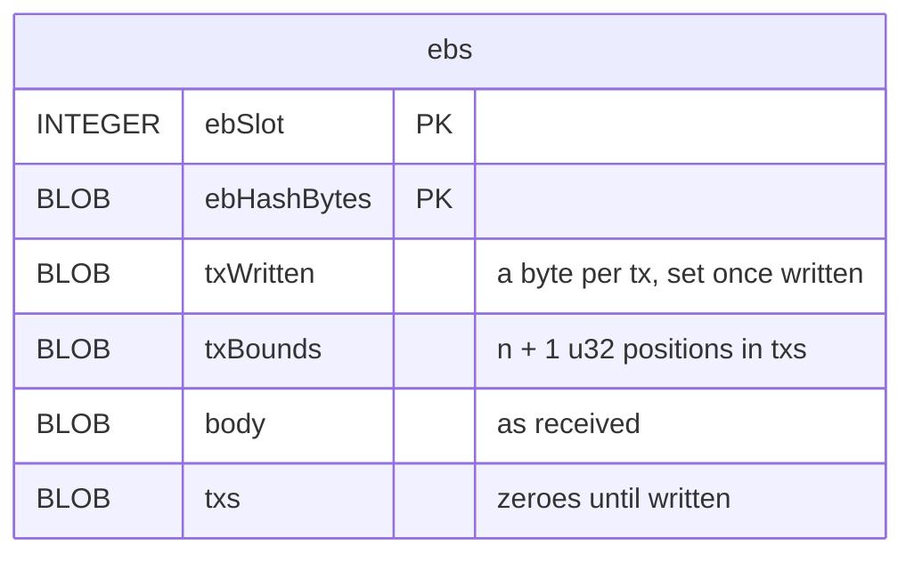

# LeiosDB

LeiosDB stores Leios endorser blocks (EBs) and their transactions.
Its SQLite backend keeps them in two files, called partitions:

- **Volatile partition** stores fresh EB announcements, bodies and transaction that the node downloads or forges.
- **Immutable partition** stores complete EBs (and their closure transactions) that a certificate on the immutable chain refers to.

The EBs and their closures are copied from the volatile to the immutable partition when the blocks certifying them become older than [`k`](../references/glossary.md#security-parameter) (the Praos security parameter). See also the [ImmutableDB](../references/glossary.md#chaindb) glossary entry.

## Database schema

Both partitions have one table, `ebs`, with one row for each pair of slot and EB hash that an announcement named.
Announcements that name the same pair share the row.
Each row holds the whole EB:

- `txWritten` is a byte per transaction the body lists, set once the transaction is written.
- `txBounds` is where each transaction is in the closure: n + 1 positions as 32-bit big-endian words, transaction `i` being the closure's bytes from position `i` up to position `i + 1`, and the last position the closure's size. For two transactions of 64 and 1024 bytes, it is the 12 bytes `00000000 00000040 00000440`: the first spans bytes 0 to 63, the second bytes 64 to 1087.
- `body` is the body in the bytes it was received in.
- `txs` is the closure: the bytes of the EB's transactions, concatenated.

The table is fully denormalized; we're essentially using SQLite only for its durability and concurrency control.
A transaction that belongs to two EBs is stored twice, and an EB announced at several slots is stored at each.
The worst case, every slot naming a different EB, shares nothing anyway, so the partition's size depends only on how many points it holds, however often EBs repeat.
And reads and writes touch one row, with no joins.

The columns go from small to large, as reading one walks the overflow pages of every column before it.
Once its body is written, a row changes only through SQLite's incremental blob API: an `UPDATE` reads, and may rewrite, the whole row.

## Volatile partition

- When an EB body arrives at a point, the point's row is inserted, with a closure and markers of zeroes. Points share nothing, even when they name the same EB: the LeiosFetch fetches and writes each on its own, so one point's writes never need to touch other points' rows. In the same SQL transaction that writes the body, whichever of its Cardano transactions the node holds at another point, of this EB or another, are copied from there, each only if its bytes hash and length match the body's claim.
- Each transaction write fills its transactions in place, in the point's row, through SQLite's incremental blob API, and sets their bytes in `txWritten` the same way. A transaction is dropped if the body is not stored, its offset is not in the body, or its size is not the declared one. LeiosDB does not track whether an EB is complete: the fetch logic, which requested the transactions, knows that. A read tells which transactions are written from `txWritten`, without reading their bytes.
- Only at startup, to seed what the node holds, does LeiosDB judge completeness: a point is complete if each of its transactions is marked written, or, for a point read from the immutable partition, if that holds it. This scan decodes no body and checks no hash for it, since hashes were confirmed when the transactions were originally written.
- Reads take the row at the requested point: in the immutable partition if the point is older than the promoted slot (see below), else in the volatile one, and never fall back to the other. A read of the volatile partition that a promotion and a collection overtook, deleting the row after the read chose the partition, reads the immutable one instead, which that promotion filled.
- Serving a body reads `body` only. Serving transactions reads the requested transactions' slice of `txBounds`, then only their bytes from `txs`, one read per run of consecutive offsets. Neither read decodes the EB.
- Resolving the closure, for voting and applying, splits `txs` at `txBounds`. Checking the transactions against the body's hashes is the caller's.

Indexes:

| Index                 | On                 | Used for                  |
|-----------------------|--------------------|---------------------------|
| `idx_ebs_ebHashBytes` | `ebs(ebHashBytes)` | Looking up an EB by hash  |

The primary key `(ebSlot, ebHashBytes)` serves the lookups by point, the garbage collection's scan by slot, and finding the newest promoted point. The blob API opens a row by its implicit rowid.

### Promotion and garbage collection

Before the ChainDB appends blocks to the ImmutableDB, it promotes the EBs they certify: it copies each into the immutable partition, at its certified point, in one transaction.
It then advances the promoted slot to the slot of the newest of those blocks, even if they certify nothing.
Only reads of a point older than the promoted slot go to the immutable partition, and every point there that the immutable chain certifies is promoted.
An EB the immutable partition holds already is not copied again: a crash can lose the volatile writes that completed it, and nothing fetches them again.
So every block in the ImmutableDB has the EB it certifies in the immutable partition.
A crash before the blocks are appended leaves only the EBs copied, and the next start copies them again.
An EB whose closure is incomplete fails the promotion, and the node stops: ChainSel adopts a block certifying an EB only once the EB's closure is complete.

Neither the ImmutableDB nor the LeiosDB syncs its writes to disk, so a power loss can drop the newest writes of either, and leave the ImmutableDB with a block certifying an EB that the immutable partition lacks.
After such an unclean shutdown, the ImmutableDB validates all its chunks when it opens, and checks each block against its predecessor: it truncates before the first block that certifies an EB the immutable partition does not hold, and the node fetches the blocks after it again.
Promotion commits in chain order, so the LeiosDB loses only the newest EBs.

A garbage collection deletes the rows before the promoted slot, in writer jobs of a bounded number of rows each, so the writes queued meanwhile wait for one job at most.
So it never deletes a row that reads still go to, nor one that a promotion still needs.
The point and body writes of a point before the promoted slot are dropped, as a collection would delete them anyway: such a point is promoted or not certified, and the fetch logic ignores announcements older than the ImmutableDB tip.

The promoted slot is kept in memory only, and never goes back while the LeiosDB is open.
At startup it is the one after the newest point in the immutable partition, which the primary key finds without a scan.
That may lag the slot the latest promotion reached, but no point at or after it is promoted, so its reads lose nothing by going to the volatile partition.
It is ahead of the ImmutableDB tip only if a crash came between a promotion and the appends of its blocks; the points in between then were not collected yet, and the next start copies the same blocks again.
Truncating the immutable partition, as the db-truncater does, lowers it at the next start.

## Immutable partition

The immutable partition has the same `ebs` table.
Promotion copies only EBs whose certificate is on the chain, and only once each of their transactions is written, and GC never removes EBs from this partition.
Thus every row holds its whole EB.
