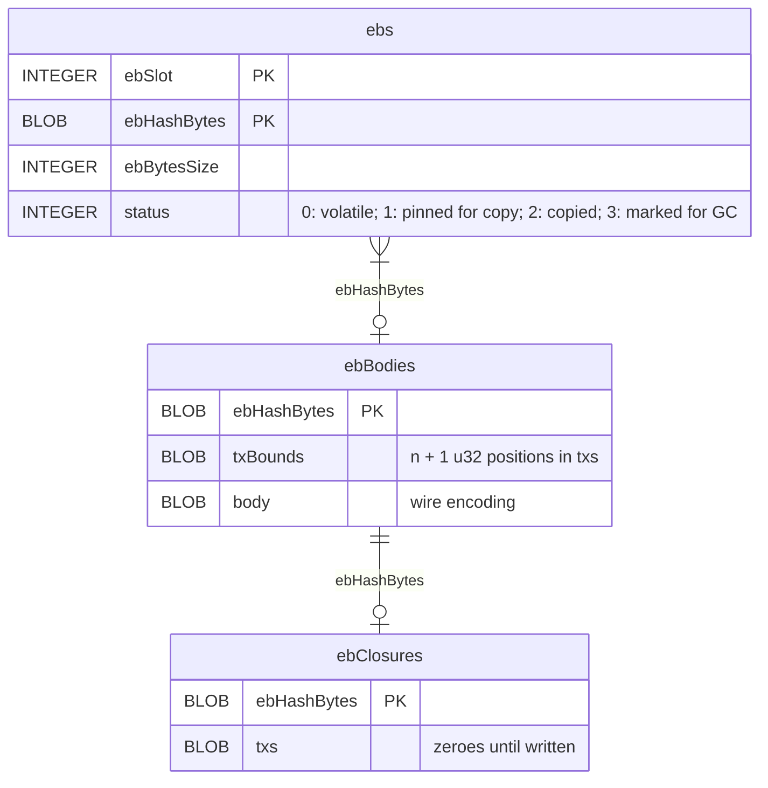
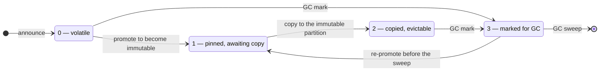
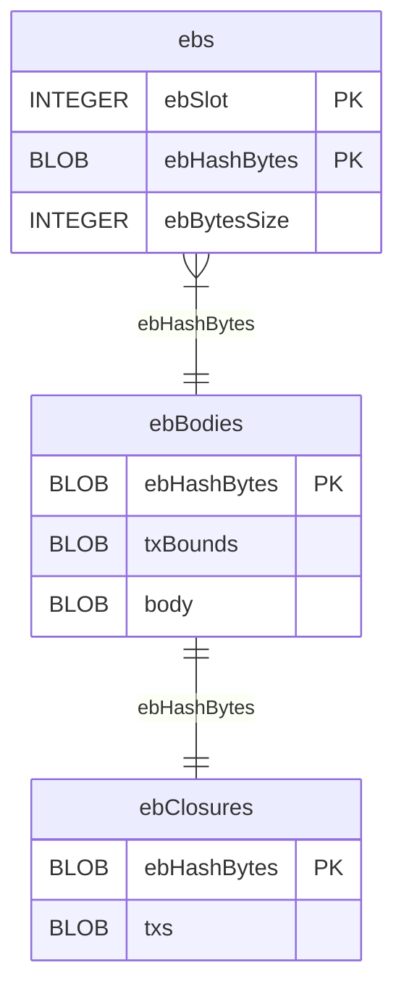

# LeiosDB

LeiosDB stores Leios endorser blocks (EBs) and their transactions.
Its SQLite backend keeps them in two files, called partitions:

- **Volatile partition** stores fresh EB announcements, bodies and transaction that the node downloads or forges.
- **Immutable partition** stores complete EBs (and their closure transactions) that a certificate on the immutable chain refers to.

The EBs and their closures are copied from the volatile to the immutable partition when they become older than [`k`](../references/glossary.md#security-parameter) (the Praos security parameter). See also the [ImmutableDB](../references/glossary.md#chaindb) glossary entry.

## Database schema

- `ebs` has one row for each pair of slot and EB hash that an announcement named; announcements that name the same pair share the row, and its `ebBytesSize` is the size claimed by the first one written. Thus one EB hash can occur at several slots.
- `ebBodies` is the EB body, one row per EB hash, however many `ebs` rows name it. `body` is the body as received, in its wire encoding, so serving it is a copy. `txBounds` is where each transaction is in the closure: n + 1 positions as 32-bit big-endian words, transaction `i` being the closure's bytes from position `i` up to position `i + 1`, and the last position the closure's size.
- `ebClosures` stores the EB closure, one row per EB hash: `txs` is the bytes of its transactions, concatenated. The EB owns these bytes: a transaction that belongs to two EBs is stored twice (ie duplicated aka denormalized.)

## Volatile partition

- When an EB body arrives, one `ebBodies` row is inserted.
- When the first transactions arrive, the `ebClosures` row is inserted with zeroes for all of them. Each write then fills its transactions in place, through SQLite's incremental blob API. A transaction is dropped if the body is not stored, its offset is not in the body, or its size is not the declared one. LeiosDB does not track whether an EB is complete: the fetch logic, which requested the transactions, knows that. A transaction not written yet reads as zeroes.
- Serving a body reads `body` only. Serving transactions reads the requested transactions' slice of `txBounds`, then only their bytes from `txs`, one read per run of consecutive offsets. Neither decodes the EB.
- Resolving the closure, for voting and applying, splits `txs` at `txBounds`. Checking the transactions against the body's hashes is the caller's.
- The GC sweep phase deletes the `ebClosures`, `ebBodies` and `ebs` rows of an EB by its hash.

Indexes:

| Index                           | On                                   | Used for                                                                 |
|---------------------------------|--------------------------------------|--------------------------------------------------------------------------|
| `idx_ebs_ebHashBytes`           | `ebs(ebHashBytes)`                   | Looking up an EB by hash                                                 |
| `idx_ebs_sweepable`             | `ebs(ebSlot) WHERE status IN (0, 2)` | The GC mark scan                                                         |
| `idx_ebs_markedForGc`           | `ebs(ebHashBytes) WHERE status = 3`  | The sweeper picking EBs to evict                                         |
| `idx_ebs_pinned`                | `ebs(ebSlot) WHERE status = 1`       | The copier picking EBs to copy                                           |

### Lifecycle of an EB row

The `status` column records where an `ebs` row is in promotion and garbage collection:

## Immutable partition

The copier copies only EBs whose certificate is on the chain, hence complete, and GC never removes EBs from this partition.
Thus every `ebs` row has its body in `ebBodies` and its closure in `ebClosures`.
For the same reason, the immutable partition does not have `status`, or any index other than `idx_ebs_ebHashBytes`.
