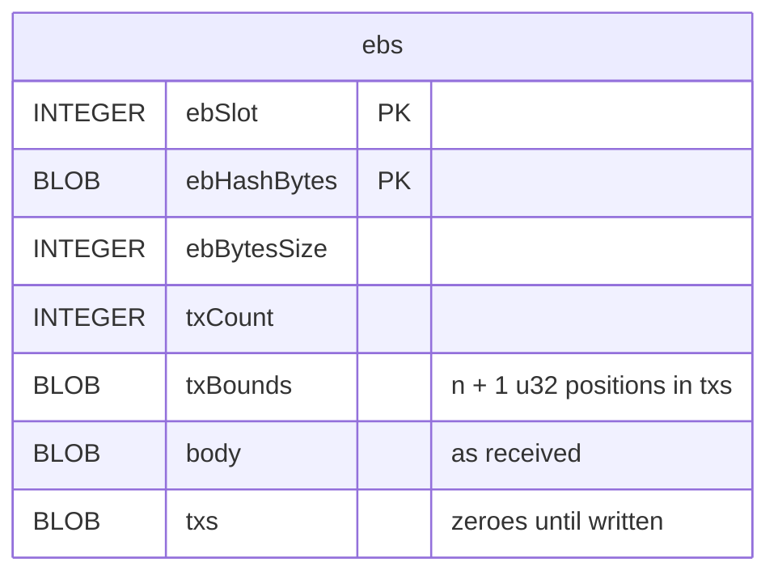

# LeiosDB

LeiosDB stores Leios endorser blocks (EBs) and their transactions.
Its SQLite backend keeps them in two files, called partitions:

- **Volatile partition** stores fresh EB announcements, bodies and transaction that the node downloads or forges.
- **Immutable partition** stores complete EBs (and their closure transactions) that a certificate on the immutable chain refers to.

The EBs and their closures are copied from the volatile to the immutable partition when the blocks certifying them become older than [`k`](../references/glossary.md#security-parameter) (the Praos security parameter). See also the [ImmutableDB](../references/glossary.md#chaindb) glossary entry.

## Database schema

Both partitions have one table, `ebs`, with one row for each pair of slot and EB hash that an announcement named.
Announcements that name the same pair share the row, and its `ebBytesSize` is the size claimed by the first one written.
Each row holds the whole EB:

- `txCount` is how many transactions the body lists.
- `txBounds` is where each transaction is in the closure: n + 1 positions as 32-bit big-endian words, transaction `i` being the closure's bytes from position `i` up to position `i + 1`, and the last position the closure's size.
- `body` is the body in the bytes it was received in.
- `txs` is the closure: the bytes of the EB's transactions, concatenated.

The table is denormalized all the way.
A transaction that belongs to two EBs is stored twice, and an EB announced at several slots is stored at each.
The worst case, every slot naming a different EB, shares nothing anyway, so the partition's size depends only on how many points it holds, however often EBs repeat.
And reads and writes touch one row, with no joins.

The columns go from small to large, as reading one walks the overflow pages of every column before it.
Once its body is written, a row changes only through SQLite's incremental blob API: an `UPDATE` reads, and may rewrite, the whole row.

## Volatile partition

- When an EB body arrives at a point, the point's row is inserted, with a closure of zeroes. Points share nothing, even when they name the same EB: each is fetched, written and collected on its own, so a write never touches another point's row. In the same transaction, the body's transactions the node holds at another point, of this EB or another, are copied from there, each only if its bytes hash to the transaction the body lists.
- Each transaction write fills its transactions in place, in the point's row, through SQLite's incremental blob API. A transaction is dropped if the body is not stored, its offset is not in the body, or its size is not the declared one. LeiosDB does not track whether an EB is complete: the fetch logic, which requested the transactions, knows that. A transaction whose bytes are still zeroes reads as not written: a valid transaction never is.
- Only at startup, to seed what the node holds, does LeiosDB judge completeness: an EB is complete if each of its transactions hashes to what its body lists, or if the immutable partition holds it.
- Reads take the row at the requested point, and fall back to the immutable partition's row of the EB, at whichever point it was certified.
- Serving a body reads `body` only. Serving transactions reads the requested transactions' slice of `txBounds`, then only their bytes from `txs`, one read per run of consecutive offsets. Neither read decodes the EB.
- Resolving the closure, for voting and applying, splits `txs` at `txBounds`. Checking the transactions against the body's hashes is the caller's.

Indexes:

| Index                 | On                 | Used for                  |
|-----------------------|--------------------|---------------------------|
| `idx_ebs_ebHashBytes` | `ebs(ebHashBytes)` | Looking up an EB by hash  |

The primary key `(ebSlot, ebHashBytes)` serves the lookups by point, and the garbage collection's scan by slot. The blob API opens a row by its implicit rowid.

### Promotion and garbage collection

Before the ChainDB appends blocks to the ImmutableDB, it promotes the EBs they certify: it copies each into the immutable partition, at its certified point, in one transaction.
An EB the immutable partition holds already is not copied again: a crash can lose the volatile writes that completed it, and nothing fetches them again.
So every block in the ImmutableDB has the EB it certifies in the immutable partition.
A crash before the blocks are appended leaves only the EBs copied, and the next start copies them again.
An EB whose transactions do not hash to its body fails the promotion, and the node stops: ChainSel adopts a block certifying an EB only once the EB's closure is complete.

A garbage collection at a slot deletes the rows before that slot, in writer jobs of a bounded number of rows each, so the writes queued meanwhile wait for one job at most.
It also drops the point and body writes of a point before the latest garbage collection's slot, as that collection would delete it anyway: the ChainDB collects up to the ImmutableDB tip, and the fetch logic ignores announcements older than that.
The slot is kept in memory only: after a restart, the next garbage collection sets it again.

## Immutable partition

The immutable partition has the same `ebs` table.
Promotion copies only EBs whose certificate is on the chain, and only once each of their transactions hashes to what the body lists, and GC never removes EBs from this partition.
Thus every row holds its whole EB.
